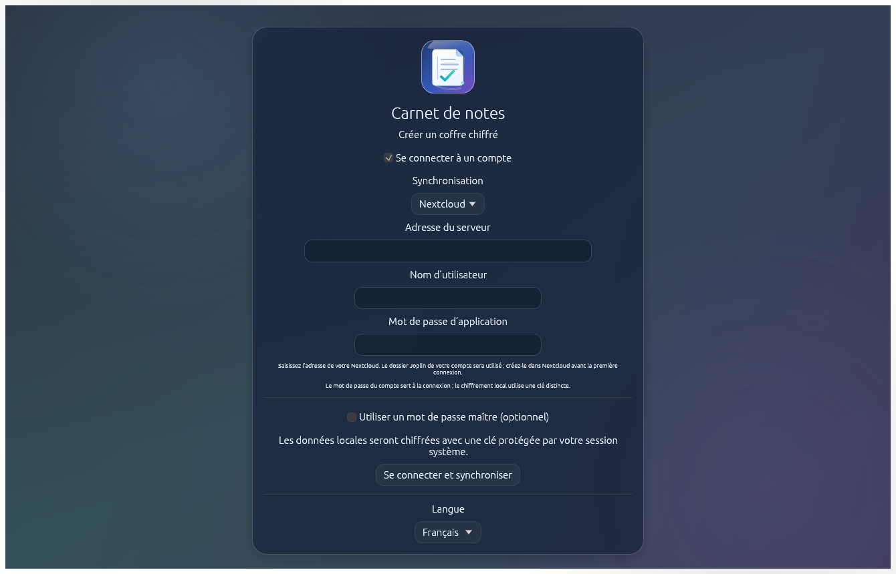

<p align="center"></p>

<h1 align="center">Carnet de notes</h1>

<p align="center"><b>Cuadernos cifrados para Windows, con Markdown, tareas, historial y sincronización experimental con Nextcloud, WebDAV y Joplin.</b></p>

<p align="center"> <a href="https://github.com/jeremdevgit/carnet-rust/releases"></a> <a href="LICENSE"></a> <a href="https://github.com/jeremdevgit/carnet-rust/actions/workflows/windows.yml"></a></p>

<p align="center"><a href="README.md">English</a> · <a href="README.fr.md">Français</a> · <b>Español</b> · <a href="README.de.md">Deutsch</a> · <a href="README.it.md">Italiano</a> · <a href="README.pt.md">Português</a> · <a href="README.zh.md">简体中文</a> · <a href="README.ja.md">日本語</a></p>

<p align="center"><a href="https://github.com/jeremdevgit/carnet-rust/releases/latest"><b>⬇ Descargar</b></a></p>


Carnet de notes es una aplicación de cuadernos nativa para Windows, con una interfaz clara/oscura inspirada en Liquid Glass. **Tus notas siempre se guardan cifradas en el disco** y puedes sincronizarlas con Nextcloud, WebDAV o Joplin Cloud/Server. Aún no hay paridad completa con Joplin: consulta [COMPATIBILITY.md](COMPATIBILITY.md).

<p> </p>

## De un vistazo

| | |
|---|---|
| **Categoría** | 📒 Productividad y datos |
| **Plataformas** | Windows |
| **Interfaz** | 8 idiomas (EN, FR, ES, DE, IT, PT, ZH, JA) |
| **Precio** | Gratis, de código abierto, sin anuncios ni telemetría |
| **Estado** | Estable |
| **Licencia** | [GPL-3.0-or-later](LICENSE) |

## Funciones

- **Cuadernos** en árbol (renombrar, mover, borrado seguro), edición y vista previa Markdown, enlaces internos, duplicado.
- **Tareas** con fechas límite, **etiquetas** (renombrar, fusionar, quitar), búsqueda de texto, listas paginadas.
- **Guardado automático** cada 800 ms, Ctrl+S / Ctrl+N, 100 versiones por nota, papelera con recuperación.
- **Vista previa de imágenes** locales (PNG/JPEG); imágenes remotas y enlaces desconocidos bloqueados.
- **Importar/exportar**: Markdown UTF-8 y JEX experimental (exportaciones sin cifrar, con aviso).
- Fuente CJK incluida para mostrar bien el chino y el japonés.

## Tus datos

- **Siempre cifrados**: notas, adjuntos, historial, borradores, índice de búsqueda, ajustes y páginas WAL se guardan con **SQLCipher**.
- **Dos modos de protección**: por defecto, una clave aleatoria guardada en el **Administrador de credenciales de Windows** (sin contraseña extra, funciona sin conexión); o una **contraseña maestra** opcional (12 caracteres o más, sin puerta trasera, bloqueo tras 5 minutos de inactividad por defecto).
- **Copias cifradas** con su propia contraseña, portables a otro PC; al restaurar se guarda antes una copia de rescate cifrada.
- Carpeta del perfil: `%LOCALAPPDATA%\jeremdevgit\CarnetRust\data`. Desinstalar la conserva.

## Sincronización (experimental)

| Servicio | Qué necesitas |
|---|---|
| **Nextcloud** | Dirección HTTPS, usuario, una *contraseña de aplicación* y una carpeta privada `Joplin` |
| **WebDAV** | La URL HTTPS completa de una carpeta dedicada a las notas |
| **Joplin Cloud / Server** | El ajuste predefinido de Cloud o la dirección API de tu servidor y tus credenciales (MFA/SSO interactivos no compatibles) |

La sincronización se ejecuta al abrir y cada cinco minutos mientras está desbloqueado; las notas siguen editables sin conexión. **El cifrado de extremo a extremo de Joplin es compatible** en ambos sentidos (verificado con Joplin CLI 3.7.1). Los conflictos piden una elección explícita, y un lote que borre el 90 % de tus notas se detiene por seguridad. HTTP solo se permite en local, se rechazan las redirecciones y la verificación TLS sigue activa. Sin E2EE, el servidor puede leer el contenido sincronizado.

## Instalar

Descarga `CarnetDeNotes-<versión>-Windows-x64-Setup.exe` de la [última versión](https://github.com/jeremdevgit/carnet-rust/releases/latest) y ejecútalo: por usuario, sin permisos de administrador. Necesita un controlador OpenGL; en Windows 11 usa Mica. El ejecutable no está firmado, así que SmartScreen puede pedir confirmación. Los perfiles de versiones anteriores se abren tal cual.

## Compilar

```powershell
# Rust 1.95+, Microsoft C++ Build Tools, Perl (OpenSSL incluido)
cargo test --locked
cargo clippy --locked --all-targets -- -D warnings
cargo build --locked --release
```

`tools/package.ps1` crea el instalador con Inno Setup 6. La CI lo compila, prueba, instala y desinstala en Windows. Detalles: [VALIDATION.md](VALIDATION.md).

**Aún no implementado**: plugins, compartir cuadernos, Web Clipper, texto enriquecido, OCR, dibujos, importación ENEX/OneNote, exportación HTML/PDF, recordatorios.

## Licencia

GPL-3.0-or-later — ver [LICENSE](LICENSE). Implementación independiente sin código, logotipo ni icono de Joplin; no afiliada a Joplin. Las bibliotecas y la fuente incluidas conservan sus licencias ([THIRD-PARTY-NOTICES.txt](THIRD-PARTY-NOTICES.txt)).

---

¿Has encontrado una vulnerabilidad? Infórmala en privado (consulta [SECURITY.md](SECURITY.md)) y no en una incidencia pública.

## Más software libre de jeremdevgit

Todos gratuitos, de código abierto y sin anuncios.

**🛠️ Sistema y hardware** — [Boîte à outils](https://github.com/jeremdevgit/boite-a-outils) · [rJb](https://github.com/jeremdevgit/rjb) · [LJ Hub](https://github.com/jeremdevgit/lj-hub) · [Decklight](https://github.com/jeremdevgit/decklight)

**📒 Productividad y datos** — [JMeca](https://github.com/jeremdevgit/jmeca) · [Suite Libre](https://jeremdevgit.github.io/suite-libre/)

**🎮 Música y juegos** — [Pomme](https://github.com/jeremdevgit/pomme) · [Ludothèque](https://github.com/jeremdevgit/ludotheque) · [AutoDex](https://github.com/jeremdevgit/autodex) · [Batailles de France](https://github.com/jeremdevgit/batailles-de-france)
