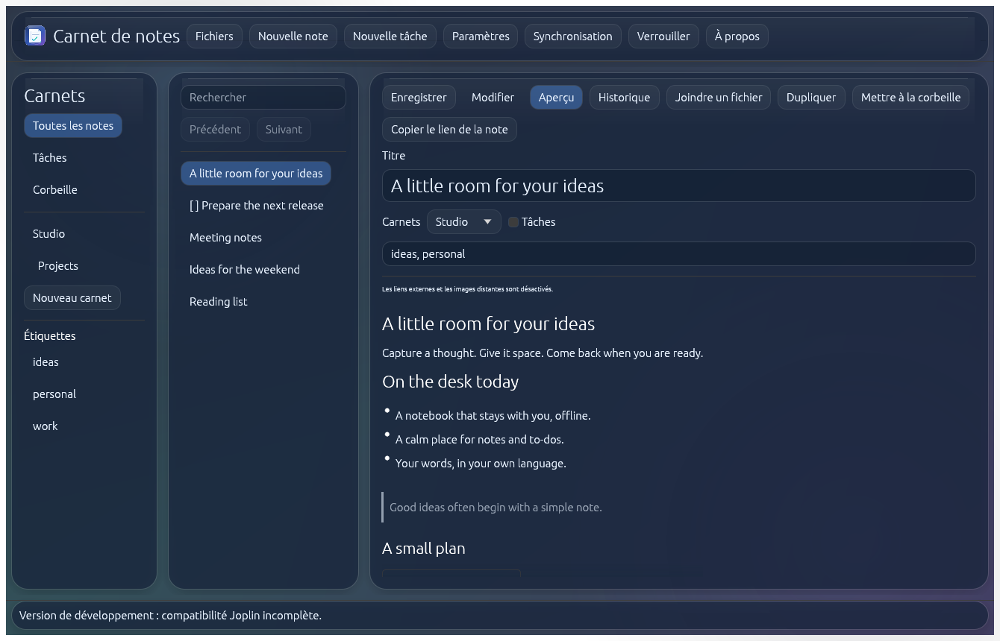
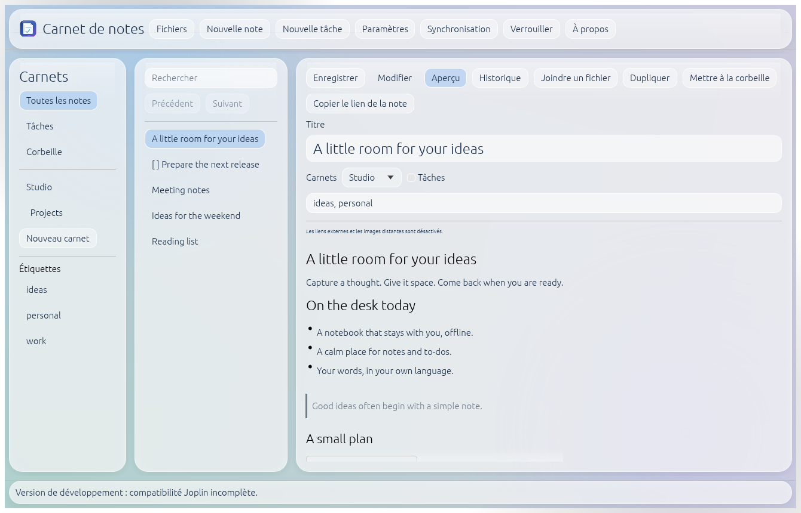

<p align="center"></p>

<h1 align="center">Carnet de notes</h1>

<p align="center"><b>Des carnets chiffrés pour Windows : Markdown, tâches, historique et synchronisation expérimentale Nextcloud, WebDAV et Joplin.</b></p>

<p align="center"> <a href="https://github.com/jeremdevgit/carnet-rust/releases"></a> <a href="LICENSE"></a> <a href="https://github.com/jeremdevgit/carnet-rust/actions/workflows/windows.yml"></a></p>

<p align="center"><a href="README.md">English</a> · <b>Français</b> · <a href="README.es.md">Español</a> · <a href="README.de.md">Deutsch</a> · <a href="README.it.md">Italiano</a> · <a href="README.pt.md">Português</a> · <a href="README.zh.md">简体中文</a> · <a href="README.ja.md">日本語</a></p>

<p align="center"><a href="https://github.com/jeremdevgit/carnet-rust/releases/latest"><b>⬇ Télécharger</b></a></p>



Carnet de notes est une application de carnets native pour Windows, à l'interface claire/sombre inspirée de Liquid Glass. **Vos notes sont toujours chiffrées sur le disque**, et vous pouvez les synchroniser avec Nextcloud, WebDAV ou Joplin Cloud/Server. La parité complète avec Joplin n'est pas encore atteinte — voir [COMPATIBILITY.md](COMPATIBILITY.md).

<p> </p>

## En bref

| | |
|---|---|
| **Catégorie** | 📒 Productivité et données |
| **Plateformes** | Windows |
| **Interface** | 8 langues (EN, FR, ES, DE, IT, PT, ZH, JA) |
| **Prix** | Gratuit, open source, sans publicité ni télémétrie |
| **État** | Stable |
| **Licence** | [GPL-3.0-or-later](LICENSE) |

## Fonctions

- **Carnets** en arborescence (renommer, déplacer, suppression sûre), édition et aperçu Markdown, liens internes, duplication.
- **Tâches** avec échéances, **étiquettes** (renommer, fusionner, retirer), recherche de texte, listes paginées.
- **Enregistrement automatique** toutes les 800 ms, Ctrl+S / Ctrl+N, 100 versions par note, corbeille avec récupération.
- **Aperçus d'images** locales (PNG/JPEG) ; images distantes et liens inconnus bloqués.
- **Import/export** : Markdown UTF-8 et JEX expérimental (exports non chiffrés, avec avertissement).
- Police CJK incluse pour afficher correctement le chinois et le japonais.

## Vos données

- **Toujours chiffrées** : notes, pièces jointes, historique, brouillons, index de recherche, réglages et pages WAL sont stockés avec **SQLCipher**.
- **Deux modes de protection** : par défaut une clé aléatoire gardée dans le **Gestionnaire d'identification Windows** (pas de mot de passe en plus, fonctionne hors ligne) ; ou un **mot de passe maître** facultatif (12 caractères minimum, sans porte dérobée, verrouillage après 5 minutes d'inactivité par défaut).
- **Sauvegardes chiffrées** avec leur propre mot de passe, transportables sur un autre PC ; la restauration conserve d'abord une copie de secours chiffrée.
- Dossier du profil : `%LOCALAPPDATA%\jeremdevgit\CarnetRust\data`. La désinstallation le conserve.

## Synchronisation (expérimentale)

| Service | Ce qu'il faut |
|---|---|
| **Nextcloud** | Adresse HTTPS, identifiant, un *mot de passe d'application* et un dossier privé `Joplin` |
| **WebDAV** | L'adresse HTTPS complète d'un dossier dédié aux notes |
| **Joplin Cloud / Server** | Le préréglage Cloud ou l'adresse API de votre serveur et vos identifiants (MFA/SSO interactifs non pris en charge) |

La synchro tourne à l'ouverture puis toutes les cinq minutes tant que le coffre est déverrouillé ; les notes restent modifiables hors ligne. **Le chiffrement de bout en bout de Joplin est pris en charge** dans les deux sens (vérifié avec Joplin CLI 3.7.1). Les conflits demandent un choix explicite, et un lot supprimant 90 % de vos notes est stoppé par sécurité. HTTP n'est autorisé qu'en local, les redirections sont refusées, la vérification TLS reste active. Sans E2EE, le serveur peut lire le contenu synchronisé.

## Installer

Téléchargez `CarnetDeNotes-<version>-Windows-x64-Setup.exe` depuis la [dernière version](https://github.com/jeremdevgit/carnet-rust/releases/latest) et lancez-le — par utilisateur, sans droits administrateur. Il faut un pilote OpenGL ; Mica est utilisé sous Windows 11. L'exécutable n'est pas signé, SmartScreen peut demander confirmation. Les profils des versions précédentes s'ouvrent tels quels.

## Compiler

```powershell
# Rust 1.95+, Microsoft C++ Build Tools, Perl (OpenSSL embarqué)
cargo test --locked
cargo clippy --locked --all-targets -- -D warnings
cargo build --locked --release
```

`tools/package.ps1` construit l'installateur avec Inno Setup 6. La CI le construit, le teste, l'installe et le désinstalle sous Windows. Détails : [VALIDATION.md](VALIDATION.md).

**Pas encore implémenté** : plugins, partage de carnets, Web Clipper, texte enrichi, OCR, dessins, import ENEX/OneNote, export HTML/PDF, rappels.

## Licence

GPL-3.0-or-later — voir [LICENSE](LICENSE). Implémentation indépendante, sans code, logo ni icône de Joplin ; non affiliée à Joplin. Les bibliothèques et la police incluses gardent leurs licences ([THIRD-PARTY-NOTICES.txt](THIRD-PARTY-NOTICES.txt)).

---

Une faille de sécurité ? Signalez-la en privé (voir [SECURITY.md](SECURITY.md)) plutôt que dans un ticket public.

## Mes autres logiciels libres

Tous gratuits, open source et sans publicité.

**🛠️ Système et matériel** — [Boîte à outils](https://github.com/jeremdevgit/boite-a-outils) · [rJb](https://github.com/jeremdevgit/rjb) · [LJ Hub](https://github.com/jeremdevgit/lj-hub) · [Decklight](https://github.com/jeremdevgit/decklight)

**📒 Productivité et données** — [JMeca](https://github.com/jeremdevgit/jmeca) · [Suite Libre](https://jeremdevgit.github.io/suite-libre/)

**🎮 Musique et jeux** — [Pomme](https://github.com/jeremdevgit/pomme) · [Ludothèque](https://github.com/jeremdevgit/ludotheque) · [AutoDex](https://github.com/jeremdevgit/autodex) · [Batailles de France](https://github.com/jeremdevgit/batailles-de-france)
