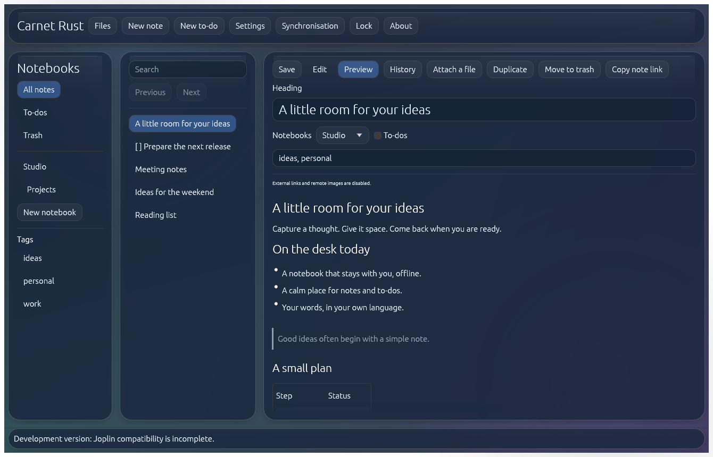
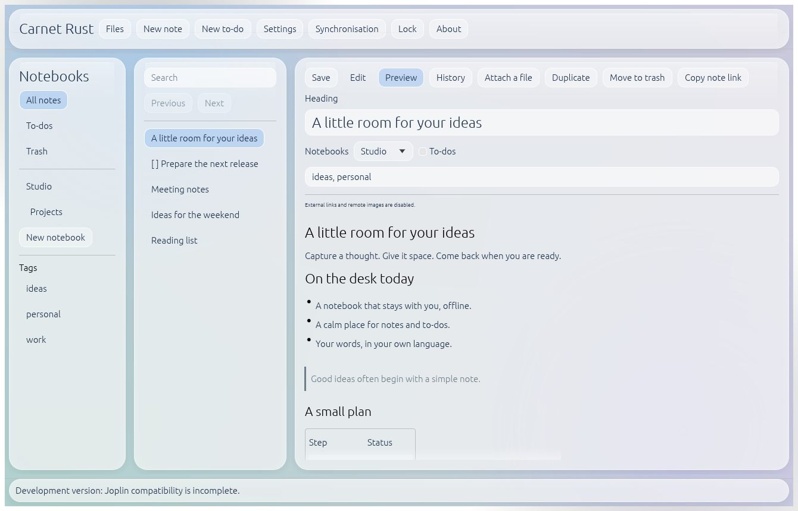
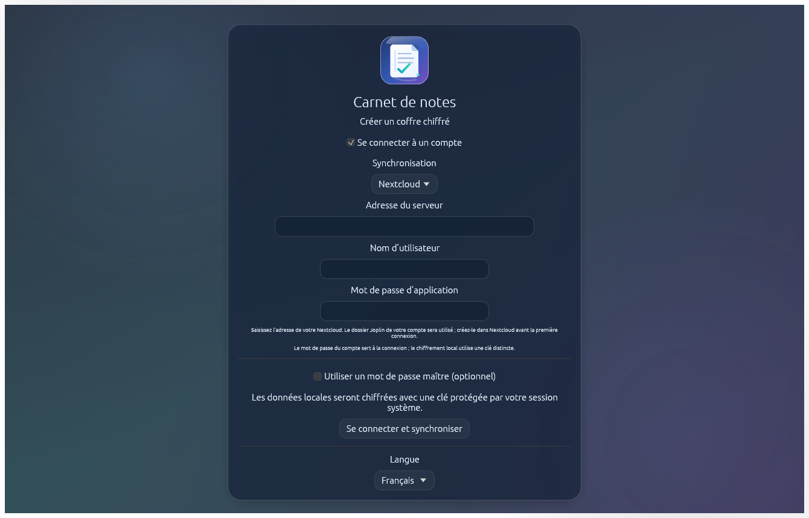

[English](README.md) · [Français](README.fr.md) · [Español](README.es.md) · [Deutsch](README.de.md) · [Italiano](README.it.md) · [Português (Brasil)](README.pt.md) · [简体中文](README.zh.md) · [日本語](README.ja.md)

 

# Carnet Rust 0.3.0

**jeremdevgit** による Windows 向けネイティブのノートアプリです。Liquid Glass に着想を得たライト／ダークテーマと８言語に対応しています。システムのクリップボードを使ったコピー・切り取り・貼り付けができ、Nextcloud、WebDAV、Joplin Cloud/Server に汎用的に接続します。個人用サーバーは設定済みではありません。ローカルデータは SQLCipher で暗号化します。**Joplin の全機能にはまだ対応していません**。詳しくは [COMPATIBILITY.md](COMPATIBILITY.md) をご覧ください。

👉 **[Carnet Rust の Windows 版をダウンロード](https://github.com/jeremdevgit/carnet-rust/releases/latest)**（`CarnetRust-0.3.0-Windows-x64.zip`、展開して使うアプリ）

 

*スクリーンショットはデモデータを使用した実際の画面を、オフスクリーンのテスト環境で撮影したものです。*

## 導入とローカル保護

Windows 用 ZIP を展開して `CarnetRust.exe` を起動してください。ローカル利用にアカウントや管理者権限は不要です。実行ファイルは署名されておらず、正常に動作する OpenGL ドライバーが必要です。Windows 11 では Mica を要求し、利用できない場合もグラデーションと半透明パネルを表示します。

標準では、ランダムな SQLCipher 鍵を **Windows 資格情報マネージャー**に保存します。オフラインでも２つ目のパスワードなしでノートを利用できます。この保護は Windows アカウントの安全性に依存し、起動のたびに Windows Hello を要求するものではありません。席を離れるときは Windows をロックしてください。同期アカウントのパスワードはデータベース鍵ではありません。

12 文字以上の**マスターパスワード**も任意で設定できます。紛失したパスワードを復旧する方法はありません。このモードでは標準で５分後に自動ロックし、システム鍵モードでは自動ロックが標準で無効です。設定画面で切り替えられます。0.2 版のプロファイルは既存のパスワードを維持します。ローカルの 0.1 版の平文プロファイルは暗号化して移行しますが、過去の外部コピーや SSD のブロックまでさかのぼって暗号化することはできません。公式 Joplin のプロファイルには触れません。

持ち運び可能な暗号化バックアップには**別のバックアップ用パスワード**が必要です。プロファイルフォルダーだけをコピーしても Windows に保存した鍵は移りません。別の PC では持ち運び可能なバックアップを復元するか、再同期してください。システムの資格情報を失うと、ローカルキャッシュを開けなくなる場合があります。

## 機能と同期

ノートブックと階層、Markdown ノートとプレビュー、期限付き To-do、タグ、検索、履歴、ごみ箱、添付ファイル、ローカル PNG/JPEG プレビューを利用できます。変更は自動保存されます。Markdown と実験的な JEX のインポート／エクスポートに対応します。エクスポートしたファイルは**暗号化されません**。

- **Nextcloud：**HTTPS サーバーアドレス、ユーザー名、アプリ用パスワードを入力します。接続前に、そのアカウントのプライベートなファイル領域に `Joplin` フォルダーを作成してください。WebDAV アドレスは自動で組み立てられ、完全な `/remote.php/` アドレスも指定できます。
- **WebDAV：**ノート専用フォルダーの完全な HTTPS アドレスを使用し、サーバーやアカウントのルートは指定しないでください。
- **Joplin Cloud/Server：**Cloud プリセット、または自分のサーバーの API アドレスと認証情報を使用します。対話型 Cloud ログイン、MFA、SSO には未対応で、実際の Cloud アカウントでは未検証です。

新しいアカウントでは起動後に自動同期し、保管庫が開いている間は５分ごとに再試行します。ネットワークや VPN がないときもローカルノートを編集できます。認証情報は暗号化した保管庫内に保存します。Nextcloud 35.0.2 と Joplin Server 3.7.1 の隔離環境でテストしましたが、一般的な互換性はまだ実験段階です。

**ローカルの SQLCipher 暗号化は Joplin のエンドツーエンド暗号化（E2EE）ではありません。E2EE の同期先、共有ノートブック、HTML ノートは、既存の暗号化を解除せずに拒否します。** E2EE が無効な同期先ではサーバーが内容を読めます。

## 状態とソースコード

Windows 版はコンパイル済みですが、実機の Windows ではまだ動作確認していません。Joplin との信頼できるメモリ／CPU 比較やセキュリティ認証もありません。E2EE、プラグイン、Web Clipper、リッチテキスト編集、OCR などは未実装です。[VALIDATION.md](VALIDATION.md) と [SECURITY.md](SECURITY.md) を参照してください。

ビルドには Rust 1.95+、Microsoft C++ Build Tools、Perl が必要です：`cargo test --locked`、`cargo clippy --locked --all-targets -- -D warnings`、`cargo build --locked --release`。オリジナルコードは GPL-3.0-or-later です。Joplin と提携していない独立したプロジェクトです。依存ライブラリのライセンスは [THIRD-PARTY-NOTICES.txt](THIRD-PARTY-NOTICES.txt) に記載しています。公開上の作者：[jeremdevgit](https://github.com/jeremdevgit)。
