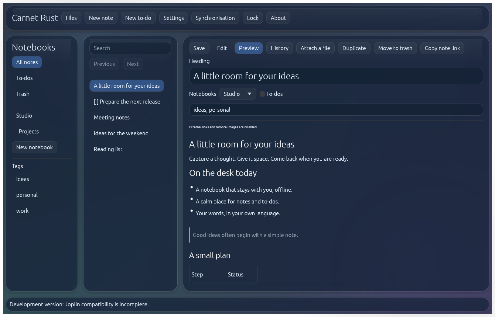

<p align="center"></p>

<h1 align="center">Carnet de notes</h1>

<p align="center"><b>Windows 用の暗号化ノート。Markdown、ToDo、履歴に加え、Nextcloud・WebDAV・Joplin との同期（実験的）に対応。</b></p>

<p align="center"> <a href="https://github.com/jeremdevgit/carnet-rust/releases"></a> <a href="LICENSE"></a> <a href="https://github.com/jeremdevgit/carnet-rust/actions/workflows/windows.yml"></a></p>

<p align="center"><a href="README.md">English</a> · <a href="README.fr.md">Français</a> · <a href="README.es.md">Español</a> · <a href="README.de.md">Deutsch</a> · <a href="README.it.md">Italiano</a> · <a href="README.pt.md">Português</a> · <a href="README.zh.md">简体中文</a> · <b>日本語</b></p>

<p align="center"><a href="https://github.com/jeremdevgit/carnet-rust/releases/latest"><b>⬇ ダウンロード</b></a></p>



Carnet de notes は、Liquid Glass 風のライト／ダーク画面を備えた Windows ネイティブのノートアプリです。**ノートはディスク上で常に暗号化**され、Nextcloud、WebDAV、Joplin Cloud/Server と同期できます。Joplin との完全な互換はまだです — [COMPATIBILITY.md](COMPATIBILITY.md) を参照してください。

<p> </p>

## 概要

| | |
|---|---|
| **カテゴリー** | 📒 生産性とデータ |
| **対応環境** | Windows |
| **表示言語** | 8 言語（英・仏・西・独・伊・葡・中・日） |
| **価格** | 無料・オープンソース・広告なし・テレメトリーなし |
| **ステータス** | 安定版 |
| **ライセンス** | [GPL-3.0-or-later](LICENSE) |

## 機能

- ツリー構造の**ノートブック**（名前変更、移動、安全な削除）、Markdown の編集とプレビュー、内部リンク、複製。
- 期限付きの **ToDo**、**タグ**（名前変更、統合、削除）、テキスト検索、ページ分割された一覧。
- 800 ミリ秒ごとの**自動保存**、Ctrl+S / Ctrl+N、ノートごとに 100 世代の履歴、復元できるごみ箱。
- ローカル画像（PNG/JPEG）の**プレビュー**。外部画像や未知のリンクハンドラーはブロック。
- **インポート／エクスポート**：UTF-8 の Markdown と実験的な JEX（書き出しは暗号化されず、警告を表示）。
- 中国語・日本語を正しく表示する CJK フォントを同梱。

## データの扱い

- **常に暗号化**：ノート、添付、履歴、下書き、検索インデックス、設定、WAL ページは **SQLCipher** で保存されます。
- **2 つの保護モード**：既定では **Windows 資格情報マネージャー**に保管したランダムな鍵（追加のパスワード不要、オフラインでも使用可）。または任意の**マスターパスワード**（12 文字以上、バックドアなし、既定で 5 分間操作がないとロック）。
- 独自のパスワードで保護された**暗号化バックアップ**は別の PC に持ち出せます。復元時はまず暗号化された救済用コピーを保存します。
- プロファイルの場所：`%LOCALAPPDATA%\jeremdevgit\CarnetRust\data`。アンインストールしても残ります。

## 同期（実験的）

| サービス | 必要なもの |
|---|---|
| **Nextcloud** | HTTPS アドレス、ユーザー名、*アプリパスワード*、非公開の `Joplin` フォルダー |
| **WebDAV** | ノート専用フォルダーの完全な HTTPS URL |
| **Joplin Cloud / Server** | Cloud のプリセット、またはサーバーの API アドレスと認証情報（対話型の MFA/SSO は非対応） |

起動時と、ロック解除中は 5 分ごとに同期します。オフラインでもノートは編集できます。**Joplin のエンドツーエンド暗号化に双方向で対応**しています（Joplin CLI 3.7.1 で検証）。競合は明示的な選択を求め、ノートの 90% を削除するような一括処理は安全のため停止します。HTTP はループバックのみ許可、リダイレクトは拒否、TLS 検証は常に有効です。E2EE を使わない場合、サーバーは同期した内容を読めます。

## インストール

[最新リリース](https://github.com/jeremdevgit/carnet-rust/releases/latest)から `CarnetDeNotes-<バージョン>-Windows-x64-Setup.exe` をダウンロードして実行します。ユーザー単位のインストールで、管理者権限は不要です。OpenGL ドライバーが必要で、Windows 11 では Mica を使用します。実行ファイルは未署名のため SmartScreen が確認を求めることがあります。以前のバージョンのプロファイルはそのまま開けます。

## ソースからビルド

```powershell
# Rust 1.95+、Microsoft C++ Build Tools、Perl（同梱 OpenSSL 用）
cargo test --locked
cargo clippy --locked --all-targets -- -D warnings
cargo build --locked --release
```

`tools/package.ps1` が Inno Setup 6 でインストーラーを作成します。CI は Windows 上でビルド、テスト、インストール、アンインストールを行います。詳細：[VALIDATION.md](VALIDATION.md)。

**未実装**：プラグイン、ノートブックの共有、Web Clipper、リッチテキスト、OCR、手書き、ENEX/OneNote のインポート、HTML/PDF の書き出し、リマインダー。

## ライセンス

GPL-3.0-or-later — [LICENSE](LICENSE) を参照。Joplin のコード、ロゴ、アイコンを含まない独自実装で、Joplin とは提携していません。同梱ライブラリとフォントはそれぞれのライセンスに従います（[THIRD-PARTY-NOTICES.txt](THIRD-PARTY-NOTICES.txt)）。

---

脆弱性を見つけたら、公開 Issue ではなく非公開で報告してください（[SECURITY.md](SECURITY.md) を参照）。

## jeremdevgit のその他のフリーソフトウェア

すべて無料・オープンソース・広告なし。

**🛠️ システムとハードウェア** — [Boîte à outils](https://github.com/jeremdevgit/boite-a-outils) · [rJb](https://github.com/jeremdevgit/rjb) · [LJ Hub](https://github.com/jeremdevgit/lj-hub) · [Decklight](https://github.com/jeremdevgit/decklight)

**📒 生産性とデータ** — [JMeca](https://github.com/jeremdevgit/jmeca) · [Suite Libre](https://jeremdevgit.github.io/suite-libre/)

**🎮 音楽とゲーム** — [Pomme](https://github.com/jeremdevgit/pomme) · [Ludothèque](https://github.com/jeremdevgit/ludotheque) · [AutoDex](https://github.com/jeremdevgit/autodex) · [Batailles de France](https://github.com/jeremdevgit/batailles-de-france)
