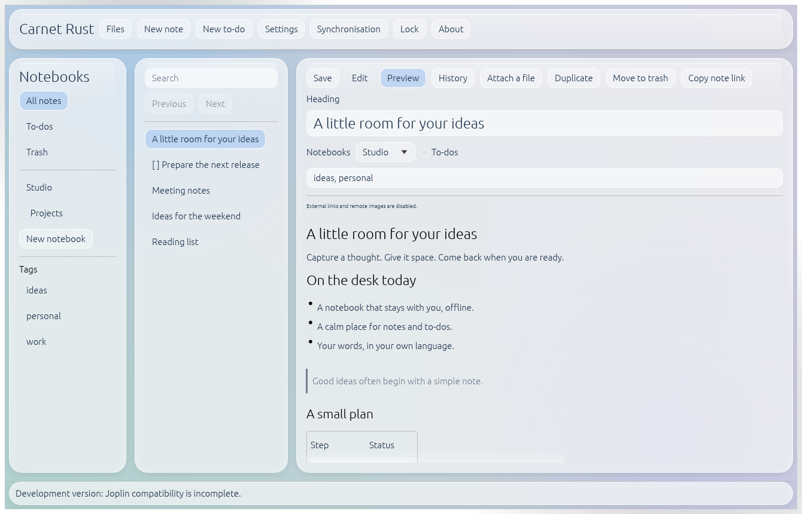

<p align="center"></p>

<h1 align="center">Carnet de notes</h1>

<p align="center"><b>Windows 加密笔记本：Markdown、待办、历史版本，以及实验性的 Nextcloud、WebDAV 和 Joplin 同步。</b></p>

<p align="center"> <a href="https://github.com/jeremdevgit/carnet-rust/releases"></a> <a href="LICENSE"></a> <a href="https://github.com/jeremdevgit/carnet-rust/actions/workflows/windows.yml"></a></p>

<p align="center"><a href="README.md">English</a> · <a href="README.fr.md">Français</a> · <a href="README.es.md">Español</a> · <a href="README.de.md">Deutsch</a> · <a href="README.it.md">Italiano</a> · <a href="README.pt.md">Português</a> · <b>简体中文</b> · <a href="README.ja.md">日本語</a></p>

<p align="center"><a href="https://github.com/jeremdevgit/carnet-rust/releases/latest"><b>⬇ 下载</b></a></p>


Carnet de notes 是一款原生 Windows 笔记本应用，采用受 Liquid Glass 启发的浅色/深色界面。**笔记在磁盘上始终加密保存**，并可与 Nextcloud、WebDAV 或 Joplin Cloud/Server 同步。与 Joplin 的完全对等尚未实现，详见 [COMPATIBILITY.md](COMPATIBILITY.md)。

<p> </p>

## 概览

| | |
|---|---|
| **类别** | 📒 效率与数据 |
| **平台** | Windows |
| **界面语言** | 8 种语言（英、法、西、德、意、葡、中、日） |
| **价格** | 免费、开源、无广告、无遥测 |
| **状态** | 稳定版 |
| **许可证** | [GPL-3.0-or-later](LICENSE) |

## 功能

- 树状**笔记本**（重命名、移动、安全删除），Markdown 编辑与预览，内部链接，复制。
- 带截止日期的**待办**、**标签**（重命名、合并、移除）、文本搜索、分页列表。
- 每 800 毫秒**自动保存**，Ctrl+S / Ctrl+N，每条笔记保留 100 个版本，回收站可恢复。
- 本地**图片预览**（PNG/JPEG）；阻止远程图片和未知链接处理程序。
- **导入/导出**：UTF-8 Markdown 和实验性 JEX（导出内容不加密，并有提示）。
- 内置 CJK 字体，中文和日文显示正常。

## 你的数据

- **始终加密**：笔记、附件、历史、草稿、搜索索引、设置和 WAL 页面都用 **SQLCipher** 存储。
- **两种保护模式**：默认使用保存在 **Windows 凭据管理器**中的随机密钥（无需额外密码，可离线使用）；或者可选的**主密码**（至少 12 个字符，无后门，默认闲置 5 分钟后锁定）。
- **加密备份**使用单独的密码，可迁移到另一台电脑；恢复前会先保存一份加密的救援副本。
- 配置文件夹：`%LOCALAPPDATA%\jeremdevgit\CarnetRust\data`。卸载时会保留。

## 同步（实验性）

| 服务 | 需要准备 |
|---|---|
| **Nextcloud** | HTTPS 地址、用户名、一个*应用专用密码*，以及一个私有的 `Joplin` 文件夹 |
| **WebDAV** | 专用笔记文件夹的完整 HTTPS 网址 |
| **Joplin Cloud / Server** | Cloud 预设，或你的服务器 API 地址和账号凭据（不支持交互式 MFA/SSO） |

打开时以及解锁期间每五分钟同步一次；离线时笔记仍可编辑。**支持 Joplin 端到端加密**，双向均可（已用 Joplin CLI 3.7.1 验证）。冲突需要你明确选择；如果某批操作会删除 90% 的笔记，会被安全机制拦下。HTTP 仅允许本机回环地址，拒绝重定向，TLS 校验始终开启。未启用 E2EE 时，服务器可以读取同步内容。

## 安装

从[最新版本](https://github.com/jeremdevgit/carnet-rust/releases/latest)下载 `CarnetDeNotes-<版本>-Windows-x64-Setup.exe` 并运行——按用户安装，无需管理员权限。需要 OpenGL 显卡驱动；在 Windows 11 上使用 Mica 效果。程序未签名，SmartScreen 可能会要求确认。旧版本的配置文件可直接打开。

## 从源码构建

```powershell
# Rust 1.95+、Microsoft C++ Build Tools、Perl（用于内置 OpenSSL）
cargo test --locked
cargo clippy --locked --all-targets -- -D warnings
cargo build --locked --release
```

`tools/package.ps1` 使用 Inno Setup 6 生成安装程序。CI 会在 Windows 上构建、测试、安装并卸载它。详情：[VALIDATION.md](VALIDATION.md)。

**尚未实现**：插件、共享笔记本、Web Clipper、富文本、OCR、绘图、ENEX/OneNote 导入、HTML/PDF 导出、提醒。

## 许可证

GPL-3.0-or-later，见 [LICENSE](LICENSE)。独立实现，不包含 Joplin 的代码、徽标或图标；与 Joplin 无关联。附带的库和字体保留各自许可证（[THIRD-PARTY-NOTICES.txt](THIRD-PARTY-NOTICES.txt)）。

---

发现安全漏洞？请私下报告（见 [SECURITY.md](SECURITY.md)），不要发公开 issue。

## jeremdevgit 的其他自由软件

全部免费、开源、无广告。

**🛠️ 系统与硬件** — [Boîte à outils](https://github.com/jeremdevgit/boite-a-outils) · [rJb](https://github.com/jeremdevgit/rjb) · [LJ Hub](https://github.com/jeremdevgit/lj-hub) · [Decklight](https://github.com/jeremdevgit/decklight)

**📒 效率与数据** — [JMeca](https://github.com/jeremdevgit/jmeca) · [Suite Libre](https://jeremdevgit.github.io/suite-libre/)

**🎮 音乐与游戏** — [Pomme](https://github.com/jeremdevgit/pomme) · [Ludothèque](https://github.com/jeremdevgit/ludotheque) · [AutoDex](https://github.com/jeremdevgit/autodex) · [Batailles de France](https://github.com/jeremdevgit/batailles-de-france)
