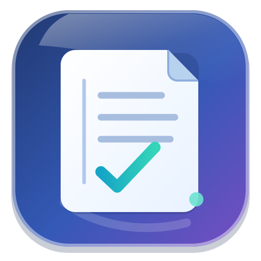

# Carnet de notes

 

[English](README.md) · [Français](README.fr.md) · [Español](README.es.md) · [Deutsch](README.de.md) · [Italiano](README.it.md) · [Português (Brasil)](README.pt.md) · [简体中文](README.zh.md) · [日本語](README.ja.md)

**jeremdevgit** 开发的 Windows 原生笔记应用，提供受 Liquid Glass 启发的明暗主题和八种语言。支持通过系统剪贴板复制、剪切和粘贴文字，可连接通用 Nextcloud、WebDAV 及 Joplin Cloud/Server 服务，未预设任何私人服务器。本地数据使用 SQLCipher 加密。**目前尚未实现 Joplin 的全部功能**；详情见 [COMPATIBILITY.md](COMPATIBILITY.md)。

👉 **[下载 Windows 版 Carnet de notes](https://github.com/jeremdevgit/carnet-rust/releases/latest)**（`CarnetDeNotes-0.4.1-Windows-x64.zip`，免安装程序）

 

*截图来自使用演示数据的真实界面，在无屏幕测试环境中采集。*

## 安装与本地加密

解压 Windows ZIP 后运行 `CarnetDeNotes.exe`。仅使用本地功能不需要账号或管理员权限。程序未签名，需要可用的 OpenGL 驱动。在 Windows 11 上会尝试启用 Mica；否则仍可使用渐变和半透明面板。

现有 0.3 配置仍位于同一加密数据目录，并沿用 Windows 凭据管理器中的原有条目。新程序无需复制或转换配置即可打开它们。

默认情况下，随机生成的 SQLCipher 密钥保存在 **Windows 凭据管理器**中。因此离线使用无需再输入一个密码。这种保护依赖 Windows 账户的安全性，程序不会在每次启动时要求 Windows Hello。离开电脑时请锁定 Windows。同步账户密码不会用作数据库密钥。

也可选择至少 12 个字符的**主密码**，此密码无法找回。主密码模式默认在闲置五分钟后锁定；系统密钥模式默认关闭自动锁定。可在设置中切换。0.2 版配置继续使用原有主密码；本地 0.1 版明文配置会迁移为加密存储，但旧的外部副本和 SSD 存储块不会因此被追溯加密。官方 Joplin 配置不会被修改。

可移植的加密备份需要**单独设置备份密码**。只复制配置文件夹不会带走 Windows 保存的密钥；换电脑时请使用可移植备份或重新同步。系统凭据丢失可能导致本地缓存无法打开。

## 功能与同步

支持笔记本及子笔记本、Markdown 笔记和预览、带截止日期的待办事项、标签、搜索、历史记录、回收站、附件以及本地 PNG/JPEG 预览。修改会自动保存。支持 Markdown 和实验性 JEX 导入导出；导出的文件**未加密**。

- **Nextcloud：**输入服务器 HTTPS 地址、用户名和应用密码。首次连接前，请在该账户的私人文件区创建 `Joplin` 文件夹。程序会生成 WebDAV 地址，也接受完整的 `/remote.php/` 地址。
- **WebDAV：**使用专门存放笔记的文件夹的完整 HTTPS 地址，不要使用服务器或账户根目录。
- **Joplin Cloud/Server：**使用 Cloud 预设或自有服务器的 API 地址及账号密码。暂不支持交互式 Cloud 登录、MFA 或 SSO；尚未用真实 Cloud 账号测试。

新账户默认在打开后自动同步，解锁期间每五分钟重试一次。无网络或 VPN 时，本地笔记仍可编辑。凭据保存在加密的本地库中。已通过 Nextcloud 35.0.2 和 Joplin Server 3.7.1 的隔离测试；整体兼容性仍处于实验阶段。

**本地 SQLCipher 加密不等于 Joplin 端到端加密（E2EE）。程序会拒绝 E2EE 目标、共享笔记本和 HTML 笔记，不会关闭现有加密。**若目标未启用 E2EE，服务器能够读取同步的内容。

## 项目状态与源码

Windows 程序已编译，但尚未在真实 Windows 电脑上运行验证。目前没有与 Joplin 的可靠内存/CPU 对比，也没有安全认证。E2EE、插件、Web Clipper、富文本编辑器、OCR 等功能尚未实现。参阅 [VALIDATION.md](VALIDATION.md) 和 [SECURITY.md](SECURITY.md)。

编译需要 Rust 1.95+、Microsoft C++ 构建工具和 Perl：`cargo test --locked`、`cargo clippy --locked --all-targets -- -D warnings`、`cargo build --locked --release`。原创代码采用 GPL-3.0-or-later 许可证。本项目独立开发，与 Joplin 无关联。依赖项许可证见 [THIRD-PARTY-NOTICES.txt](THIRD-PARTY-NOTICES.txt)。公开作者：[jeremdevgit](https://github.com/jeremdevgit)。
